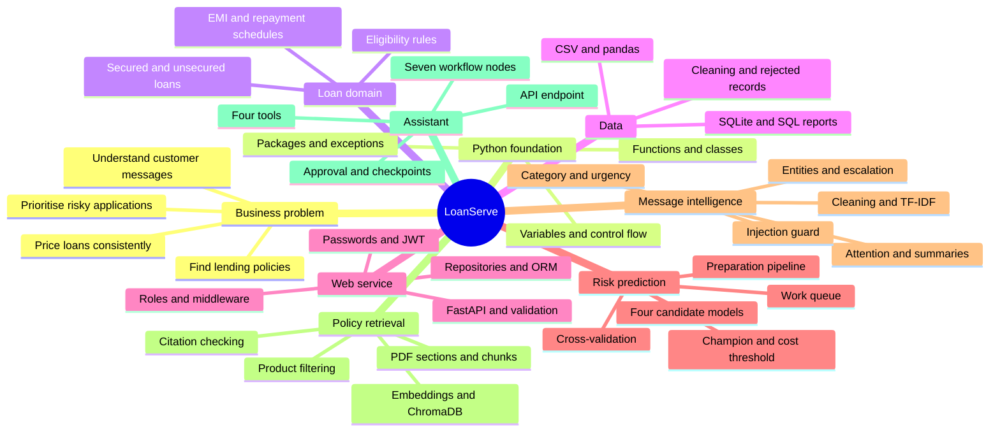
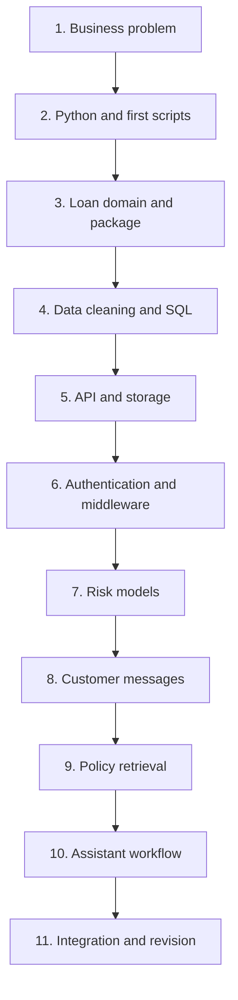
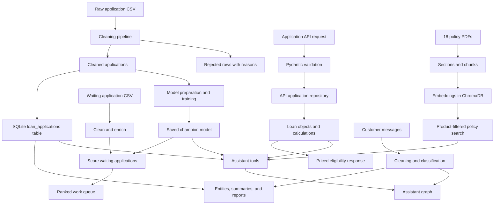
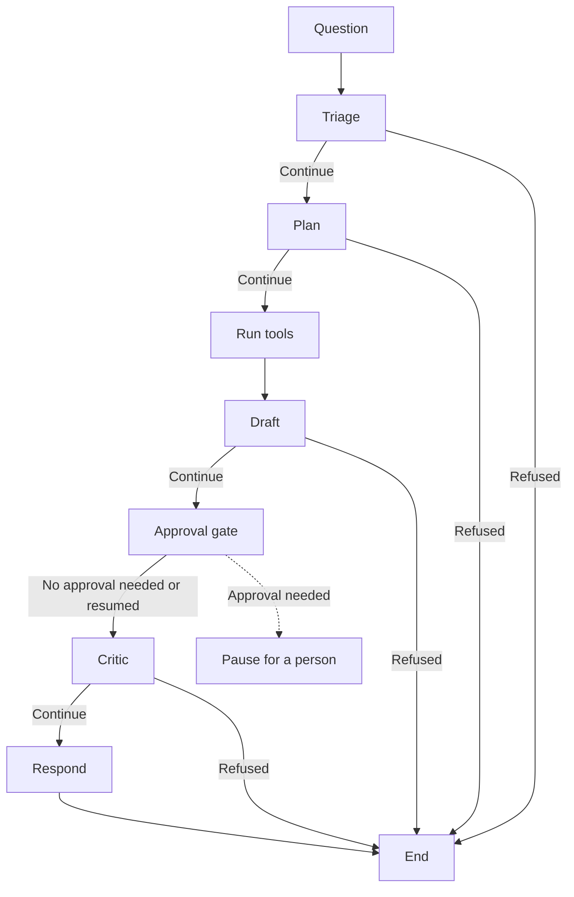

# LoanServe: From Zero to Understanding the Whole Project

> **Living study guide:** We will expand this same file as each lesson is explained. It contains the learning plan now; detailed lesson notes will be added as we study the code.
>
> **Started:** 25 October 2026 · **Current position:** Before Lesson 1 · **Progress:** 0 of 11 stages completed

## Contents

- [How to use this guide](#how-to-use-this-guide)
- [Project mind map](#project-mind-map)
- [Learning roadmap and progress](#learning-roadmap-and-progress)
- [The complete study plan](#the-complete-study-plan)
- [How the project fits together](#how-the-project-fits-together)
- [Study routine](#study-routine)
- [Lesson notes](#lesson-notes)
- [Glossary](#glossary)
- [Questions to revisit](#questions-to-revisit)
- [Revision and practice](#revision-and-practice)
- [Updates](#updates)

## How to use this guide

Our goal is to understand **what each module does, why it exists, how the code works, and how it connects to the rest of LoanServe**. We will learn concepts when the project needs them, beginning with the business problem.

For each lesson, we will add plain-English explanations, the relevant files and functions, a worked example, important code details, diagrams where useful, exercises, and revision notes. Earlier notes will remain available, and corrections will be recorded explicitly.

### Sources and what they mean

| Source | What we use it for |
| --- | --- |
| [Assignment PDF](LTIM_AIServicesB2_Set1IP1.pdf) | The intended requirements for the 38-day project |
| [Project source](Project/) | What your current implementation actually does |
| [Task planner](LoanServe_TaskPlanner.pdf) | The original day-by-day build order |
| [Original learning guide](LOAN_BIBLE.pdf) and [simplified learning guide](LOAN_BIBLE_v2.o.pdf) | Supporting explanations and presentation preparation |
| [Saved reports](Project/output/) | Results already recorded by previous runs; these are not fresh verification |

**Important distinction:** Some later modules use simplified rules or omit behavior requested by the assignment. We will label notes as **Current code**, **Assignment requirement**, or **Possible improvement** wherever that distinction matters. A function name or comment alone does not prove that the behavior is implemented.

All source paths in this guide are relative to `Project/` unless a link says otherwise. Commands will state their working directory. Credentials and private configuration values must not be copied into study notes.

Mermaid diagrams render in viewers that support Mermaid. If your viewer displays the diagram code instead, the surrounding tables and text provide the same learning structure.

## Project mind map

## Learning roadmap and progress

The stages below are a learning sequence, not the original assignment's day numbers. A stage is complete only after we study it and practise explaining it.

| Stage | Focus | What you should be able to explain afterward | Status |
| --- | --- | --- | --- |
| 1 | Business and lending basics | What LoanServe solves and who uses it | Not started |
| 2 | Python and the first scripts | How the initial eligibility check runs | Not started |
| 3 | Package and loan domain | How loan objects price and evaluate applications | Not started |
| 4 | Data cleaning and SQL | How raw records become usable data and reports | Not started |
| 5 | Web API and storage | How an application request becomes a response | Not started |
| 6 | Authentication and middleware | How signup, login, tokens, roles, and limits work | Not started |
| 7 | Machine learning | How models produce risk scores and the work queue | Not started |
| 8 | Message intelligence | How raw messages become structured information | Not started |
| 9 | Policy retrieval | How policy passages are found and cited | Not started |
| 10 | Assistant workflow | How the assistant connects the earlier components | Not started |
| 11 | Integration and revision | How to run, trace, explain, and evaluate the whole project | Not started |

## The complete study plan

### Stage 1: Understand the business problem

Before opening code, learn:

- What LoanServe is and who uses it: loan officers, the risk team, and the servicing desk.
- Home, vehicle, gold, and personal loans.
- Principal, interest, tenure, EMI, collateral, credit score, default, and eligibility.
- The problems being solved: manual pricing, risk prioritisation, customer messages, scattered policies, and access through one service.
- What information enters the platform and what results leave it.

**Practice:** Explain the project to someone who does not know programming.

**Checkpoint:** You can describe the business problem without listing technology names.

### Stage 2: Learn Python through the first two scripts

Learn variables, strings, numbers, input/output, arithmetic, conditions, loops, lists, dictionaries, functions, and classes.

| File | What we will study |
| --- | --- |
| [day01_loan_eligibility.py](Project/scripts/day01_loan_eligibility.py) | Six inputs, EMI calculation, opening repayment schedule, and eligibility decision |
| [day02_loan_pricing.py](Project/scripts/day02_loan_pricing.py) | Reorganising calculations and rules into functions and a class |

We will calculate one loan example manually and trace the changing values through the code. Then we will compare the two scripts to understand why the structure changes.

**Practice:** Predict the result before running an example; change one input and explain its effect.

**Checkpoint:** You can follow a simple program and explain the initial eligibility check.

### Stage 3: Understand the package and loan rules

Learn:

- Files, modules, packages, imports, and `__init__.py`.
- Objects, constructors, attributes, methods, inheritance, and overriding.
- Factory functions and how they select a class.
- Exceptions and error handling.
- Regular expressions and identifier validation.
- Decorators and shared constants.
- Why different parts of the system reuse the same calculations.

| Files | Responsibility to understand |
| --- | --- |
| `config/constants.py` | Shared lending rules and platform settings |
| `loanserve/core/loan_calculations.py` | EMI, income ratio, and repayment balances |
| `loanserve/core/entities.py` | Base, secured, and unsecured loan objects |
| `loanserve/core/validators.py` | PAN, mobile, and email validation |
| `loanserve/core/exceptions.py` | Named domain errors |
| `loanserve/core/decorators.py` | Argument checks and timing wrappers |
| `loanserve/data_access/file_storage.py` | CSV storage and loading objects |

**Practice:** Trace the factory creating a secured loan and then a personal loan. List the shared rules and additional rules each receives.

**Checkpoint:** You can explain how a loan object prices and evaluates an application.

### Stage 4: Follow CSV data into SQLite

Start with rows, columns, CSV files, pandas DataFrames, missing values, duplicates, and basic NumPy operations.

Study:

- `loanserve/data_access/cleaning_pipeline.py`
- `loanserve/data_access/database_loader.py`
- `loanserve/data_access/database_reports.py`
- The repayment schedule in `loanserve/core/loan_calculations.py`.

Learn SQL through the queries used here: `SELECT`, `WHERE`, `GROUP BY`, `HAVING`, aggregation, sorting, and parameterised queries.

Connect the original data to the cleaned files, the rejected-record report, and the database. Explain fault precedence: a row can have several problems while the report records the first applicable reason.

**Practice:** Follow a valid row and an invalid row through the cleaning process. Explain one SQL report in plain English.

**Checkpoint:** You can explain what happens to each kind of record and why rejected records remain auditable.

### Stage 5: Understand the web service

Learn these concepts before following their implementation:

- Clients, servers, HTTP requests, and responses.
- URLs, endpoints, JSON, and status codes.
- GET, POST, PUT, and DELETE.
- FastAPI and Pydantic request/response models.
- Request validation versus lending eligibility.
- Repositories, abstract interfaces, SQLAlchemy, and table relationships.

| Files | What we will trace |
| --- | --- |
| `api/schemas.py` | The accepted request and promised response shapes |
| `api/application_factory.py` | How a fresh application is assembled |
| `api/repository.py` | In-memory and SQL-backed storage |
| `api/orm_models.py` | Applicant/application tables and their relationship |
| `api/routers/loan_applications.py` | Create, read, replace, delete, list, and schedule endpoints |

The paths above are inside `loanserve/`.

**Practice:** Trace incoming JSON through validation, storage, domain calculations, and response construction.

**Checkpoint:** You can explain what happens when someone submits an application through the API.

### Stage 6: Learn authentication and middleware

Learn:

- Password hashing, salts, and Argon2.
- Signup, login, JWT claims, and bearer tokens.
- Authentication versus authorisation.
- Loan-officer and administrator roles.
- Rate limiting, CORS, request logging, and audit logging.
- Why 401, 403, and 429 represent different situations.

Study `loanserve/api/password_hashing.py`, `access_control.py`, `middleware.py`, `routers/user_accounts.py`, and their wiring in `application_factory.py`.

**Practice:** Trace signup → login → token → protected request. Explain an expired token, a forbidden action, and a request over the rate limit.

**Checkpoint:** You can explain who a caller is, what they are permitted to do, and how requests are recorded and limited.

### Stage 7: Learn machine learning through default prediction

Build the foundation first:

- Features and target; training versus prediction.
- Training, validation, and holdout data.
- Data leakage and why preparation belongs inside the fitted pipeline.
- Missing-value treatment, scaling, and one-hot encoding.
- Class imbalance and class weighting.
- Confusion matrices, precision, recall, and ROC-AUC.

Then study the model workflow in this order:

| Order | Topic | Module in `loanserve/risk_models/` |
| --- | --- | --- |
| 1 | Shared preparation and reproducible splitting | `feature_pipeline.py` |
| 2 | Logistic regression and saving/loading a fitted pipeline | `baseline_model.py` |
| 3 | Decision trees and random forests | `tree_models.py` |
| 4 | Linear SVM and comparison across folds | `cross_validation.py` |
| 5 | EMI-related features and credit bands | `feature_engineering.py` |
| 6 | Hyperparameter search and champion selection | `champion_model.py` |
| 7 | Pricing prediction mistakes and choosing a threshold | `champion_model.py` |
| 8 | Scoring and prioritising waiting applications | `work_queue.py` |

Read the corresponding JSON and CSV outputs alongside the code. Keep cross-validation results, holdout results, and training results clearly labelled.

**Practice:** Explain a false positive and a false negative in lending terms, then calculate their costs with a small example.

**Checkpoint:** You can distinguish eligibility from predicted risk, defend the model comparison, and explain how the queue is produced.

### Stage 8: Understand customer-message processing

Use short sample messages to make every transformation visible.

| Order | Topic | Module in `loanserve/message_intelligence/` |
| --- | --- | --- |
| 1 | Remove correspondence wrapping and mask references | `text_cleaning.py` |
| 2 | TF-IDF, category prediction, and urgency prediction | `message_classifier.py` |
| 3 | Vectors, dot products, softmax, and attention | `attention.py` |
| 4 | Extractive sentence selection | `thread_summary.py` |
| 5 | LLM settings, prompts, JSON replies, and caching concepts | `llm_client.py` |
| 6 | References, currency amounts, dates, and database linking | `entity_extraction.py` |
| 7 | Batch processing and individual message failures | `batch_pipeline.py` |
| 8 | Prompt-injection patterns and innocent lookalikes | `injection_guard.py` |
| 9 | Urgency, sentiment, exposure, and human escalation | `escalation.py` |

For the LLM and escalation sections, explicitly compare the current implementation with the required network calls and sentiment analysis. Do not assume these exist just because the files are present.

**Practice:** Follow one message from raw text to classification, extracted facts, and an escalation decision. Compare an extractive summary with an abstractive one.

**Checkpoint:** You can explain which steps are text rules, trained models, mathematical operations, or intended LLM work.

### Stage 9: Learn policy search and grounded answering

Learn:

- Reading all pages of a PDF.
- Sections, headings, chunks, and chunk identifiers.
- Embeddings, semantic similarity, and cosine distance.
- ChromaDB persistence and metadata.
- Filtering by loan product while retaining general policies.
- Building prompts from retrieved passages.
- Checking whether cited identifiers were actually retrieved.
- Why valid citation identifiers do not prove that every sentence is supported.

Study everything in `loanserve/retrieval/`, the 18 policy PDFs, `data/policy_documents_manifest.json`, and `data/retrieval_evaluation_set.json`.

**Practice:** Trace a personal-loan policy question through product detection, filtering, retrieval, and citation checking. Consider a question the policy book cannot answer.

**Checkpoint:** You can explain the retrieval process and distinguish retrieval, answer generation, and answer validation.

### Stage 10: Understand the assistant workflow

Learn:

- Tools, arguments, and tool errors.
- Shared state, state patches, and collecting channels.
- Nodes, edges, and conditional routing.
- The intended roles of planner, resolver, critic, and responder.
- Human approval, interrupts, checkpoints, and resuming a run.
- How the assistant is exposed through the API.

| File in `loanserve/` | Role |
| --- | --- |
| `assistant/tools.py` | Wrap earlier calculations, lookup, prediction, and retrieval |
| `assistant/state.py` | Define the data carried through the graph |
| `assistant/agents.py` | Current planning and response logic; compare with intended LLM agents |
| `assistant/nodes.py` | Implement graph steps and their state updates |
| `assistant/graph.py` | Connect seven nodes and refusal routes |
| `assistant/workflow.py` | Run the graph with SQLite checkpointing |
| `api/routers/assistant.py` | Serve assistant requests |

**Practice:** Trace an EMI question, a policy question, and a request that needs approval. Identify where current behavior differs from the intended workflow, especially planning, confidence checks, and resumption.

**Checkpoint:** You can explain which components execute for a question and what information passes between them.

### Stage 11: Integrate, revise, and prepare to explain

Practise four complete journeys:

1. A loan application being priced and checked.
2. A waiting application receiving a risk score.
3. A customer message being processed.
4. A policy question passing through the assistant.

Then study:

- Running the project from the correct directory and in dependency order.
- Reading errors and tracing failures to their source.
- Distinguishing expected outputs, saved results, and newly verified results.
- Implementation gaps, limitations, and possible improvements.
- A two-minute introduction and a longer code walkthrough.
- Interview questions answered in your own words.

**Checkpoint:** You can explain the whole project, follow a request across modules, and honestly describe its limitations.

## How the project fits together

### Major data paths

This is a conceptual map of the main components. It does not imply that every assignment feature is fully implemented or that API-created applications automatically enter the training database.

### Assistant graph

The graph below reflects the main node order and refusal routing in the current source. Checkpointing exists, but the public workflow's approval-resume behavior must be examined separately in Stage 10.

### Keep these distinctions clear

| Pair | Difference we will learn |
| --- | --- |
| Request validation vs eligibility | Is the input acceptable in shape and value range, versus does the application pass lending rules? |
| Eligibility vs risk prediction | Published rule checks versus a model's estimated probability of default |
| Training vs prediction | Learning a model from examples versus using a fitted model |
| Authentication vs authorisation | Establishing identity versus deciding permitted actions |
| Extractive vs abstractive summary | Selecting existing sentences versus generating a rewritten summary |
| Retrieval vs generation | Finding source passages versus composing an answer |
| Citation validity vs factual support | A cited source exists among retrieved passages versus it actually supports the claim |
| Checkpointing vs resumption | Saving state versus continuing a saved run correctly |
| Assignment vs implementation | Required behavior versus behavior present in the code |

## Study routine

Suggested pace: **8–10 weeks at 1–2 hours a day**, adjusted to understanding. This is an estimate, not a deadline. The assignment's 38 days describe its build schedule rather than a guaranteed learning duration.

### Every lesson follows this sequence

1. Explain the problem in everyday language.
2. Introduce the concepts needed for that lesson.
3. Read relevant code in small sections.
4. Trace an example and show how values change.
5. Connect the code to earlier and later modules.
6. Practise with a small exercise and understanding checks.
7. Add revision notes to this file.

| Activity | Example time allocation |
| --- | --- |
| Understand concepts | 20 minutes |
| Read and discuss code | 35 minutes |
| Trace or change an example | 20 minutes |
| Explain it back and revise | 10 minutes |

## Lesson notes

**No lessons have been completed yet.** The first lesson will be **“What is LoanServe, what problem does it solve, and how does a loan work?”**

As lessons are delivered, add a dated subsection here using this structure. Update the contents and stage progress when appropriate. Keep notes from earlier lessons and link back to concepts already explained.

### Structure for each future lesson

| Section | What to record |
| --- | --- |
| Lesson title and date | Topic, stage, and learning status |
| Plain-English explanation | What problem we are solving and why |
| New concepts | Definitions, analogies, and examples |
| Code references | Relative links to the actual files and named functions/classes |
| Code walkthrough | Small excerpts with explanations of inputs, operations, and outputs |
| Worked example | Step-by-step values; label manual calculations versus executed results |
| Visual explanation | A flowchart, mind map, sequence diagram, or comparison table where useful |
| Connections | Who calls this code and what later work depends on it |
| Current code vs requirement | Verified differences, with references |
| Common mistakes | Misunderstandings and edge cases discussed |
| Practice and answers | Exercises, expected reasoning, and any unresolved questions |
| Revision notes | Key points worth rereading |

## Glossary

We will grow this table as terms are explained. The initial entries are starting definitions; lessons will add examples and links.

| Term | Plain-English starting definition | First studied in |
| --- | --- | --- |
| Principal | The amount borrowed | Stage 1 — planned |
| Interest | The charge for borrowing money | Stage 1 — planned |
| Tenure | The agreed repayment period | Stage 1 — planned |
| EMI | Equated monthly instalment: a regular payment combining principal repayment and interest | Stage 1 — planned |
| Collateral | An asset pledged as security for a loan | Stage 1 — planned |
| Default | Failure to meet repayment obligations; the dataset provides a target label for this outcome | Stage 1 — planned |
| Module | A Python file that contains reusable code | Stage 3 — planned |
| API | An interface through which software requests operations or information | Stage 5 — planned |
| Feature | An input used by a machine-learning model | Stage 7 — planned |
| Target | The outcome a supervised model learns to predict | Stage 7 — planned |
| LLM | Large language model: a model that processes and generates language | Stage 8 — planned |
| RAG | Retrieval-augmented generation: finding relevant information before generating an answer from it | Stage 9 — planned |

## Questions to revisit

Add questions here whenever something needs another explanation. Mark an item resolved only after it has been addressed.

| Question | Related stage | Status | Answer or lesson link |
| --- | --- | --- | --- |
| No questions recorded yet | — | — | — |

## Revision and practice

Use these questions throughout the course rather than memorising answers in advance:

- What business problem does this component solve?
- What are its inputs and outputs?
- Which file and function implement it?
- What happens for a normal example?
- What happens for invalid or missing input?
- Which earlier component does it reuse?
- Which later component depends on it?
- Is its result calculated by a rule, predicted by a trained model, or generated by an LLM?
- Does the current implementation match the assignment here?
- What evidence supports the result I am explaining?

### Final understanding checklist

- [ ] Explain LoanServe in plain English.
- [ ] Trace the Day 1 script without skipping the arithmetic.
- [ ] Explain the class hierarchy and factory.
- [ ] Follow raw data through cleaning and SQL storage.
- [ ] Trace an application API request and response.
- [ ] Explain authentication, roles, and middleware.
- [ ] Explain model preparation, comparison, and threshold selection.
- [ ] Trace a customer message through the processing components.
- [ ] Explain policy retrieval and citation checks.
- [ ] Trace the seven-node assistant graph.
- [ ] Describe implementation gaps without claiming missing features work.
- [ ] Give a project introduction and demonstrate the main journeys.

## Updates

| Date | Change |
| --- | --- |
| 25 October 2026 | Created the full study plan, progress table, mind map, flow diagrams, glossary, lesson-note structure, and revision checklist. No lessons marked complete. |
